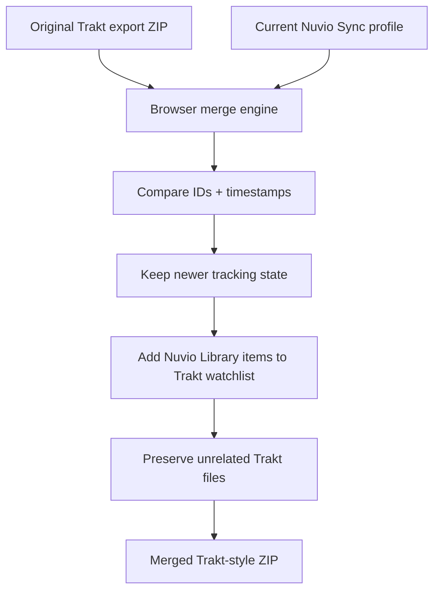

# Trakt ↔ Nuvio Sync Migration Tool

<p align="center">
  <strong>A private, browser-only migration, merge, and repair tool for Trakt exports and Nuvio Sync.</strong>
</p>

<p align="center">
  
  
  
  
</p>

<p align="center">
  <a href="https://yungzanji.github.io/nuvio-trakt-importer/"><strong>Open the migration tool</strong></a>
  ·
  <a href="CHANGELOG.md">Changelog</a>
  ·
  <a href="PRIVACY.md">Privacy</a>
  ·
  <a href="SECURITY.md">Security</a>
</p>

---

## What it does

The site now has two separate workflows:

| Direction | Purpose |
| --- | --- |
| **Trakt → Nuvio** | Import a Trakt export ZIP into Nuvio Sync with safe merge, mirror, or reset strategies. |
| **Nuvio → Trakt** | Merge newer Nuvio Library, watched-state, and Continue Watching data back into an original Trakt export ZIP. |

Both workflows run in the browser. The project has no application server, database, analytics, cookies, or persistent browser storage.

The original Trakt ZIP is never uploaded by this tool. Reverse export creates a separate merged ZIP and never modifies the source archive on disk.

---

# Trakt → Nuvio

This is the original importer workflow. It is useful when Nuvio's normal Trakt connection does not reproduce a large history completely, or when you want a controlled migration using the files in your own Trakt export.

## Supported mappings

| Trakt data | Nuvio destination | Notes |
| --- | --- | --- |
| Watchlist | Library | Includes metadata/artwork enrichment when available |
| Watched movies | Watched status | Relevant timestamps are retained |
| Watched episodes | Watched status | Stored by show + season + episode |
| Playback / progress | Continue Watching | Trakt percentage is converted to milliseconds using runtime metadata |

Ratings, social activity, and independent personal-list membership are not forced into unrelated Nuvio fields. They remain in the original Trakt ZIP.

## Import strategies

After reading the selected Nuvio profile, the importer previews the changes before writing anything.

| Strategy | Behavior |
| --- | --- |
| **Only bring new items** | Adds missing Trakt records without overwriting matching Nuvio records. |
| **Merge & refresh** | Adds missing records and keeps the newer watched/progress timestamp. Recommended for most migrations. |
| **Mirror the Trakt import** | Makes the supported Nuvio tracking categories reflect the Trakt import more closely. |
| **Reset tracking data & import fresh** | Clears Library, watched status, and Continue Watching, verifies the clear, then rebuilds them from Trakt. |

Destructive modes require explicit typed confirmation and read-back verification.

## Artwork repair

The site can also repair poster/background URLs in an existing Nuvio Library without performing a Trakt import.

The user supplies their own TMDB API Read Access Token. The token is kept only in page memory during the lookup and is cleared afterward.

---

# Nuvio → Trakt

The reverse exporter is designed for the case where Trakt was your old tracker, you later used Nuvio as your source of truth, and you now want an updated Trakt-style archive containing the newer Nuvio tracking state.

It requires:

1. Your original Trakt export ZIP.
2. A Nuvio Sync sign-in.
3. The Nuvio profile you want to merge.

No Trakt API key, Trakt OAuth login, or Trakt application credentials are required to generate the merged archive.

### Choose the download format

After reviewing individual Nuvio changes, pick one:

- **Trakt backup archive (.zip):** preserves the complete original Trakt backup, plus selected newer Nuvio watchlist, history and Continue Watching updates. **Do not upload this to Trakt's JSON File importer**; the nested backup format is not the website import schema.
- **Trakt website import (.json):** a flat JSON array using `imdb_id`, `tmdb_id`, `trakt_id`, or `tvdb_id`, together with `type`, `watched_at`, and `watchlisted_at`. Upload it under **Trakt → Settings → Data → Import → JSON File**. By default it contains **only new selected Nuvio history and watchlist entries**, avoiding the need to re-import thousands of watches already in Trakt. Check **Include all original Trakt history too** if migrating to an empty Trakt account.

**Episode matching safety:** Trakt needs a real **episode-level** identifier for `type: "episode"`. The exporter first reuses episode IDs from your original Trakt archive. If some new episodes have only the parent show ID, choose JSON mode, enter your TMDB Read Access Token and click **Resolve missing episode IDs**. The browser requests public show/season metadata directly from TMDB, reuses season results, and clears the token; it never sends your watch history or login details. Unmatched episodes block downloading an incomplete JSON file unless you explicitly exclude those changes.

**Playback limitation:** Trakt's website JSON import does not support Continue Watching positions/percentages. The ZIP preserves those positions; the JSON file imports watch history and watchlist dates only. Exact replay events are limited to what Nuvio actually retains.

**Validation:** Preview the JSON import on Trakt before confirming it. Existing Trakt watch history may contain the original records; leave "include original history" off to avoid importing those events again.

### Direct-sync safety and retry behavior

- **Selection applies to sync:** Only checked review items can be sent to Trakt. Changing checkboxes invalidates the live plan; always re-run **Compare with live Trakt account** before confirming. The boxes are locked during in-flight writes.
- **Watch timestamps:** Trakt normalizes `watched_at` to the start of each minute. The live comparison uses that same precision, including the `start_at` query boundary. Without this, successful writes can be incorrectly shown again in the next comparison.
- **Previously confirmed batches:** When Trakt acknowledges a complete batch, its records are remembered in the current browser tab so an immediate retry does not re-send them if live reads lag. On reload, the live Trakt API comparison is still authoritative.
- **Unfinished progress ≥80%:** Trakt currently rejects a pause at high completion percentages with a 422 `Use stop to scrobble`. Calling `stop` would mark it watched; this migration deliberately **does not** silently convert it. Such selections are shown as unsupported and **skipped in direct sync**, while the original percentage and pause timestamp remain available in the merged ZIP.
- **Rate limits:** Authenticated writes are spaced to respect the Standard API limit of one write per second. If an error occurs, the tool reports confirmed counts, stops immediately, and requires a new comparison; it never blindly replays a failed batch.

## Direct Trakt sync (OAuth PKCE)

In addition to downloading Trakt backup ZIPs and Trakt-compatible JSON, the **Nuvio → Trakt** workflow offers a **direct Trakt sync** option. It can send user-approved, newly watched Nuvio movies/episodes, Nuvio Library items (to Trakt Watchlist), and unfinished playback percentages (using Trakt's pause-scrobble endpoint).

This option is a **one-time, explicitly confirmed migration**, not automatic background synchronization.

1. Register a Trakt API app at [Trakt My Apps](https://app.trakt.tv/oauth/applications). Set its **redirect URI** to `https://yungzanji.github.io/nuvio-trakt-importer/` and its **JavaScript/CORS origin** to `https://yungzanji.github.io`.
2. Enter its **Client ID** in Step 4; **never enter a Client Secret**. Click **Authorize Trakt (PKCE)** and grant access in the popup. Keep the main tab open.
3. Upload the original Trakt ZIP, sign into Nuvio and review individual changes. Resolve unknown **episode IDs** using your TMDB Read Access Token as needed.
4. Click **Compare with live Trakt account**. The tool reads current watch history, watchlist, and playback and identifies only missing/newer items.
5. Click **Confirm and sync to Trakt**. No writes occur before this explicit confirmation. The tool never calls Trakt deletion endpoints.

New-only sync does not re-upload the full original Trakt history. Pause positions use Trakt's `/scrobble/pause` API; progress percentages are preserved, but **Trakt assigns a fresh paused timestamp** rather than copying Nuvio's original pause time. The ZIP retains the original timestamp.

**Privacy:** Trakt OAuth PKCE has no Client Secret; Client ID and access token are held only in the active page's memory, not cookies, persistent storage, or a backend. Trakt/Nuvio requests are made directly from the browser. An app-specific CORS origin must be configured at Trakt. Disconnect or close the tab to discard the Trakt token.

**Failures:** Rate limits, app permission restrictions, and unmatched IDs can prevent migration. The tool reports confirmed writes, stops on errors, and requires a fresh comparison before retrying. This functionality passes mocked API tests, but it has not yet been verified by a real OAuth session on the owner's Trakt account.

*This application uses Trakt but is not endorsed or certified by Trakt.*

---
## Reverse merge rules

The original Trakt export remains the historical base.

### Nuvio Library → Trakt Watchlist

Every Nuvio Library item that is not already represented in the Trakt watchlist is added to the Trakt watchlist.

This applies to both movies and TV shows. Nuvio Library items are deliberately treated as **watchlist items**, not Collection items or custom-list entries.

The existing Trakt watchlist is retained, so the result is a union rather than a destructive mirror.

### Watched state

For each movie or episode, the tool compares the latest known Trakt watched timestamp with the Nuvio watched timestamp.

- If Trakt is newer or equal, the Trakt state is retained.
- If Nuvio is newer, a new watched event is added to the Trakt history and the appropriate watched summary is updated.
- Older Trakt history events remain in the archive.

This means a title started or tracked earlier in Trakt but finished later in Nuvio will end with the newer Nuvio watched state represented in the merged archive.

### Continue Watching / playback

Nuvio stores playback position and duration in milliseconds. The exporter converts those values back into a Trakt playback percentage.

For the same movie or episode:

- the newest pause timestamp wins;
- an older Nuvio progress value cannot overwrite newer Trakt playback;
- a newer Nuvio progress value can replace older Trakt playback;
- if the item was subsequently marked watched, stale playback from before that watched timestamp is removed.

### Trakt-only data

Ratings, custom lists, social data, preferences, and other unrelated Trakt export files are left alone.

Files that do not need a watch-history-related change are copied into the new ZIP without being rewritten. Only the tracking files that actually require a merge are regenerated.

## ID matching

The reverse exporter reconciles supported IMDb, TMDB, Trakt, and TVDB identifiers found in the original archive. This helps avoid duplicate records when Nuvio identifies an item using a different supported public ID than the one that appears first in the Trakt record.

## Important replay limitation

Nuvio Sync exposes the current watched state and latest watched timestamp; it does not provide this tool with a complete event-by-event replay history.

If you watched the same movie or episode multiple times after leaving Trakt, the exporter can preserve the newest known watched state, but it cannot reconstruct every missing replay event that Nuvio never stored separately.

---

# Reverse-export workflow



Before download, the UI shows projected counts for:

- Nuvio Library items being added to the Trakt watchlist;
- newer watched states being added;
- playback positions being added or updated;
- stale playback positions being removed because a later watched state exists;
- final watch-history, watchlist, and playback counts.

---

# Nuvio Sync access

The browser uses Nuvio's TV-style approval flow and the Sync functions exposed to the approved session.

The current implementation reads:

- profiles;
- Library;
- watched movie/episode states;
- Continue Watching / playback state.

The reverse exporter is read-only with respect to Nuvio. It never writes back to the selected Nuvio profile.

---

# Privacy model

| Data | Where it goes |
| --- | --- |
| Trakt ZIP contents | Browser memory only; never uploaded by this project |
| Nuvio approval/session token | Directly between the browser and Nuvio; held in memory |
| Nuvio tracking records | Directly between the browser and Nuvio Sync |
| User-supplied TMDB token | Directly from the browser to TMDB during requested metadata/artwork lookup |
| Public media IDs / episode coordinates | Metadata provider only when a metadata lookup is requested |
| Site request metadata | GitHub Pages may receive normal web-hosting request logs |

The application does not intentionally store credentials or tracking data in cookies, `localStorage`, `sessionStorage`, IndexedDB, an application database, or an application server.

Google Sans Flex is bundled into the generated HTML, so the application does not need Google Fonts at runtime.

See [PRIVACY.md](PRIVACY.md) for the complete disclosure.

---

# Safety controls

For Trakt → Nuvio writes:

- mandatory pre-change backup;
- projected change preview;
- typed confirmation for destructive strategies;
- staged clears for fresh reset;
- read-back verification after writes;
- operations stop when expected destructive steps cannot be verified.

For Nuvio → Trakt export:

- Nuvio is read-only;
- the original Trakt ZIP is not modified on disk;
- a new ZIP is generated as a separate download;
- unrelated Trakt files are preserved;
- only newer Nuvio state is allowed to supersede older tracking state.

The generated application bundle uses a hash-based Content Security Policy and restricts network connections to the services needed by the selected workflow.

---

# Run locally

```sh
npm ci
npm run build
npm test
npm run verify:bundle
```

Then open the generated `index.html` or `Nuvio-Trakt-Importer.html` in a current browser.

The generated page is self-contained, including the ZIP parser and bundled font. There is no application server to configure.

---

# License

Application code: [MIT License](LICENSE)  
Google Sans Flex: [SIL Open Font License 1.1](FONT-LICENSE.txt)  
Other bundled notices: [THIRD_PARTY_NOTICES.txt](THIRD_PARTY_NOTICES.txt)

This is an independent community project and is not affiliated with or endorsed by Nuvio, Trakt, or TMDB.
